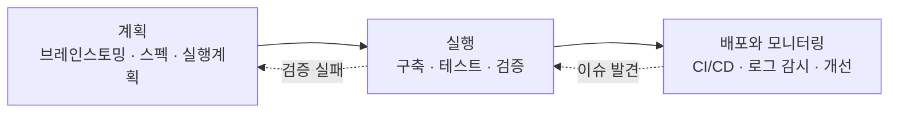
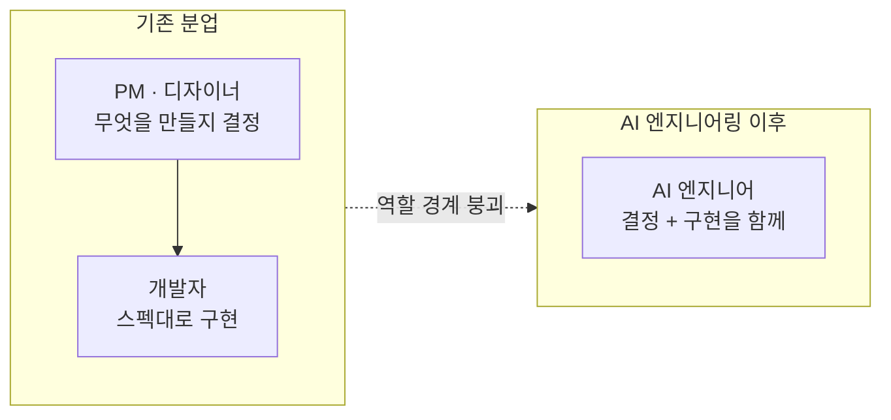

# Andrew Ng — AI 엔지니어링 역량을 위한 4가지 핵심 스킬

## 앤드류 응 5부작 레터 전체 정리 (2026.08.14 \~ 09.11)

## 한눈에 보기

앤드류 응이 2026년 8월 14일부터 9월 11일까지 다섯 편의 레터로 발표한 **AI Engineering Skills Map**의 전체 내용이다. 그가 던진 핵심 메시지는 이것이다. **AI 엔지니어링에 능숙해지면 당신의 최고의 성과는 남이 정해준 스펙을 구현하는 일이 아니라, 무엇을 만들지를 직접 빚어내는 일이 된다.**

Skills Map은 **4개의 상위 축**으로 이루어지고, 각 축이 다시 5\~6개의 하위 스킬로 나뉜다. Part 1이 지도 전체를 제시했고, Part 2\~5가 축을 하나씩 펼쳤다.

| 레터 | 발행일 | 다룬 내용 | 하위 스킬 |
| --- | --- | --- | --- |
| Part 1 | 08.14 | Skills Map 전체 지도와 도출 방법론 | 상위 축 4개 |
| Part 2 (#367) | 08.21 | 축 1 — AI 애플리케이션 구축·배포 | 6개 |
| Part 3 (#368) | 08.28 | 축 2 — 소프트웨어 엔지니어링 기본기 | 5개 |
| Part 4 (#369) | 09.04 | 축 3 — 코딩 에이전트 활용 | 5개 |
| Part 5 (#370) | 09.11 | 축 4 — 빌드를 주도하기 | 4개 |

## Skills Map 본편: 4개의 상위 축

출처: Andrew Ng, [The AI Engineering Skills Map (Part 1)](https://www.deeplearning.ai/the-batch/the-ai-engineering-skills-map), 2026년 8월 14일

**어떻게 도출했나.** 응과 그의 팀은 채용공고 1만 건 이상을 분석하고, AI 전문가·채용 관리자·리크루터와 수십 건의 구조화 인터뷰를 진행했으며, 설문 데이터와 온라인 데이터를 종합했다. 그는 이 과정을 방대한 채용·전문가 인터뷰 데이터셋에 클러스터링을 돌린 것에 비유한다. 목표는 두 가지다. 개발자가 **무엇부터 배울지 우선순위를 정하도록** 돕는 것, 그리고 고용주가 **역량 있는 개발자를 채용하도록** 돕는 것.

**용어 주의: 'AI 엔지니어'라는 직함이 아니라 'AI 엔지니어링 역량'이다.** 응은 후자가 훨씬 넓기 때문에 이 표현을 쓴다고 명시한다. 오늘날 모든 개발자가 클라우드를 다룰 줄 알아야 하지만 '클라우드 엔지니어' 직함을 가진 사람은 소수인 것과 같다. 풀스택·데이터·DevOps·ML 엔지니어 모두에게 AI 엔지니어링 역량이 필요해진다.

## 축 1 — AI 애플리케이션 구축·배포 (Part 2)

AI 애플리케이션과 일반 소프트웨어의 핵심 차이는 **출력이 덜 예측 가능하다**는 점이다. LLM이 무엇을 출력할지, 지도학습 알고리즘이 어떤 예측을 할지 미리 알 수 없다. 이 불확실성 때문에 AI 시스템 구축은 전통적 소프트웨어보다 **훨씬 반복적인 과정**이 되고, 과정을 미리 계획하기가 어렵다.

숙련된 AI 엔지니어는 소프트웨어를 만들고, 살펴보고, 다음에 무엇을 시도할지 정하기를 반복한다. 각 단계는 중간 결과에 크게 좌우된다. 응은 이렇게 말한다 — **다음에 무엇을 할지 능숙하게 결정할 수 있어야 신뢰할 수 없는 AI 부품들로 신뢰할 수 있는 소프트웨어 시스템을 만들 수 있다.**

**1) LLM 기초.** LLM이 입력을 어떻게 토큰화하고 출력을 생성하는지 이해하면, 언제 믿고 언제 실패할 수 있는지 판단할 수 있다. 멀티모달 모델을 쓸 시점, 컨텍스트 윈도에 무엇을 넣을지의 트레이드오프, 캐시 히트·지식 컷오프·추론 강도·샘플링 파라미터, 툴 콜링 같은 특수 기능을 쓸 때를 따질 수 있다. 나아가 적절한 모델이나 모델 조합을 고르고, 필요하면 파인튜닝이나 셀프 호스팅 같은 특수 기법을 적용한다.

**2) 데이터로 모델 접지하기(grounding).** LLM은 좋은 입력 컨텍스트가 있어야 쓸모 있는 출력을 낸다. 벡터 검색 기반 RAG는 초기 시도였을 뿐, 기법은 크게 늘었다.

- 프롬프트에 넣을 것과 LLM이 도구로 필요할 때 검색하게 할 것을 나눈다
- 데이터와 질의에 맞는 표현을 고른다 — 벡터 인덱스, 지식 그래프, 정형 데이터(고객 레코드 등) 위의 시맨틱 레이어
- 문서(텍스트·PDF·HTML·이미지)를 LLM이 읽을 수 있는 입력으로 바꾼다
- 데이터를 깨끗하고 최신으로 유지하는 파이프라인을 만든다

**3) 에이전틱 시스템 구축.** 정해진 순서로 LLM을 호출하는 워크플로부터, LLM이 스스로 다음 단계를 반복 결정하는 에이전트 하네스까지 스펙트럼이 있다.

- 아키텍처 선택 — 무엇을 체이닝하고 무엇을 병렬화할지, 언제 코드를 쓰고 언제 LLM을 쓸지, 폴백은 어떻게 둘지
- 에이전트 루프 설계 — 호출 가능한 도구(MCP, CLI, 샌드박스 실행 환경), 메모리 아키텍처, 긴 세션의 컨텍스트 관리, 단일 에이전트 대신 멀티 에이전트 오케스트레이션이 필요한 시점
- 프로토타입을 **프로덕션급으로** 전환 — 가드레일, 적대적 입력, 데이터 유출 같은 핵심 리스크의 식별과 우회, 거버넌스
- 음성 에이전트, 컴퓨터 사용 에이전트, 생성형 UI 등 자기 영역의 최신 기법을 따라간다

**4) 평가 주도 개발(evaluation-driven development).** 응이 **AI 시스템을 잘 만드는 사람을 가르는 가장 중요한 특성**으로 꼽은 항목이다. 체계적인 평가·오류 분석 루프를 돌려 개발을 이끌 수 있느냐가 관건이며, 그는 이것이 프로젝트마다, 심지어 같은 프로젝트의 단계마다 올바른 접근이 크게 달라져서 **숙달하기 까다로운 기술**이라고 말한다.

- 시스템의 트레이스와 출력을 들여다보고, 탐색적 데이터 분석을 하고, 제품·비즈니스 통찰과 결합해 **무엇을 측정할지** 정한다
- 평가 방법의 메뉴를 안다 — 언제 결정론적(코드 기반) 평가를 쓸지, 언제 LLM-as-a-judge를 쓸지, 언제 사람을 개입시킬지
- **평가 자체를 평가**해 계속 진화시킨다
- 이 평가가 반복 개발로 이어져 진전을 무작위가 아닌 체계적인 것으로 만든다

**5) 프로덕션 운영.** AI 소프트웨어 운영은 예측 불가능성·비용·지연시간 때문에 전통적 소프트웨어와 다르다.

- 실제 사용 환경에서의 성능을 파악할 **관측 가능성(observability)** 장치를 만든다
- 성능을 추적하고 드리프트를 감지하며, 모델 실패와 적대적 프롬프트 인젝션 같은 보안 사고에 빠르게 대응한다
- 회귀 테스트와 CI/CD에 전통적 소프트웨어보다 **더 많은 통계적 평가**가 필요하고, 테스트 노력은 실수의 리스크에 비례해 조정한다
- 비용과 지연시간 최적화를 위한 기법 조합을 고른다 — 모델 선택 최적화, 증류와 파인튜닝, 에이전틱 워크플로 단순화

**6) 머신러닝 기초.** 현대 LLM은 지도학습과 강화학습을 포함한 ML 기법으로 만들어진다. 응은 **자신이 아는, LLM으로 잘 만드는 엔지니어는 모두 머신러닝과 딥러닝을 어느 정도 깊이로 이해하고 있다**고 말한다.

- 주요 ML·딥러닝 모델과 정확도·학습 속도·추론 속도 등의 트레이드오프를 안다
- 모델 학습·평가에 필요한 데이터를 엔지니어링할 줄 안다
- 편향/분산, 오류 분석, 데이터 엔지니어링은 **출력이 불확실한 시스템을 다루는 핵심 멘탈 프레임워크**로 계속 유효하다

## 축 2 — 소프트웨어 엔지니어링 기본기 (Part 3)

**코딩 에이전트가 모든 코드를 써주더라도** 기본기는 중요하다. 원하는 트레이드오프를 하도록 에이전트를 조종하려면, 애초에 어떤 트레이드오프가 존재하는지 알아야 하기 때문이다. 게다가 AI 애플리케이션에서 AI 코어는 대개 더 넓은 소프트웨어 애플리케이션을 통해 표현되며, 그 애플리케이션을 빚는 것은 숙련된 엔지니어다.

응이 드는 반례는 구체적이다. 기본기 없이 바이브 코딩하는 초심자도 간단한 애플리케이션은 만들 수 있지만, 코딩 에이전트가 **지연시간·가용성·일관성·신뢰성·유지보수성·단순성·비용**에서 나쁜 트레이드오프를 하게 되는 경우가 많다. 개발자가 그런 트레이드오프가 있다는 것조차 몰랐기에, 자기 애플리케이션 맥락에 맞는 결정을 하도록 에이전트를 조종하지 못한 것이다.

**1) 풀스택 애플리케이션 구축.** 에이전틱 코딩 덕분에 프론트엔드 개발자나 모바일 개발자처럼 특화된 역할을 하던 많은 개발자가 **더 넓은 풀스택 역할**을 할 수 있게 됐다. 에이전트가 익숙지 않은 부분을 도와주지만, 스택이 실제로 어떻게 동작하는지는 이해해야 한다. UI 컴포넌트, 캐싱, 페이지 렌더링, API 선택과 설계, 인증, 상태·세션 관리, 비동기 처리, 데이터 영속성, 테스트, 보안, 접근성이 여기 들어간다.

**2) 데이터 관리.** 데이터는 소프트웨어가 그 위에 지어지는 토대이면서 **상대적으로 바꾸기 어렵기** 때문에 별도의 주의가 필요하다(에이전트가 마이그레이션을 도와준다 해도 그렇다).

- 접근 패턴을 따져 **무엇을 얼마나 오래 저장할지** 정한다
- 적절한 데이터 모델과 저장 유형(관계형 테이블, 문서, 키-값, 그래프)·인프라를 고른다 — 이 선택이 속도·확장성·가용성·신뢰성·비용을 좌우한다
- 트랜잭션과 동시성을 이해하고, 데이터를 깨끗하고 일관되고 최신으로 유지한다
- 프라이버시·거버넌스·컴플라이언스를 챙기고 데이터 수명주기를 관리한다
- 애플리케이션이 진화하면 **데이터 아키텍처도 함께 진화**시킨다

응이 특히 강조하는 지점: 데이터 관리 결정에는 사람이 제공하는 맥락이 많이 필요하다. AI 시스템은 데이터 소스에서 자기 입력 컨텍스트를 얻으므로, **데이터 아키텍처를 잘못 고르면 AI는 자기가 무엇을 모르는지조차 모른다.** 그래서 맥락을 가진 숙련자의 개입이 필요하다. 사람이나 전통적 소프트웨어가 아니라 **에이전트를 위한 데이터 인프라를 어떻게 만들 것인가**는 빠르게 진화하는 영역이므로 모범 사례를 계속 갱신해야 한다.

**3) 시스템 아키텍처 설계.** 스택과 데이터의 주요 구성 요소를 이해하면 그 조각들을 어떻게 조립할지 결정할 수 있다.

- 소프트웨어가 무엇을 해야 하는지부터 파악한다 — 사용자는 몇 명인가, 지연시간은 얼마나 중요한가, 비용은 얼마나 중요한가
- 애플리케이션 플랫폼, 프론트엔드와 백엔드의 경계, 시스템 분해, 애플리케이션 상태의 배치, 아키텍처 입도(모놀리스 대 마이크로서비스)를 결정한다
- 스택(언어, 런타임, 프레임워크, 데이터 기술)을 고르되, 때로는 **실험을 돌려 선택지를 평가한 뒤** 정한다
- **올바른 아키텍처는 움직이는 표적이다.** 빠른 프로토타입에 맞는 단순한 아키텍처가 첫 프로덕션 시스템에는 맞지 않을 수 있고, 규모가 커지면 또 달라진다

**4) 보안과 신뢰성 확보.**

- 정확성 검증을 위한 테스트 전략 — 유닛 테스트와 통합 테스트의 조합, 프레임워크 선택, 커버리지 수준
- **실패를 전제로 설계**한다 — API 레이트 리밋 같은 실패의 처리, 우아한 성능 저하(graceful degradation), 실패의 **폭발 반경 최소화**
- 먼저 만들고 나중에 보안을 챙기는 대신, 보안 작업을 생명주기의 앞쪽으로 당기는 **'shift left'** 흐름. 모든 개발자가 풀스택으로 가듯, 많은 개발자가 이제 부분적으로 보안 엔지니어이기도 하다
- AI 도구로 코드의 취약점을 스캔하고, 의존성의 공급망 인젝션을 점검하고, 클라우드 설정의 공격 표면을 살필 수 있다. 다만 이것을 잘하려면 **여전히 보안 지식이 필요하다**

**5) 확장과 프로덕션 운영.**

- SDLC 실행 — 빌드·테스트에 더해 배포 환경 구성, 릴리스 전략 결정, 배포 자동화(CI/CD), IaaS 이해
- 관측 가능성 도구 설치, 알림 설정, 인시던트 관리
- 실제 부하를 이해하고 서버 확장·로드 밸런싱, 데이터 인프라 조정(샤딩·인덱싱·복제) 또는 아키텍처 변경으로 대응
- 버전 관리, 코드 리뷰, 의존성 유지보수, **기술 부채 관리** 같은 코딩 모범 사례

**응의 결론.** 코딩 문법 암기 같은 일부 코딩 지식은 쓸모없어지고 있다. 하지만 **소프트웨어가 어떻게 동작하는지 깊이 이해하는 개발자는 이해 없이 바이브 코딩하는 사람을 압도적으로 앞선다.**

## 축 3 — 코딩 에이전트 활용 (Part 4)

코딩 에이전트를 조종하는 능력은 코드 작성뿐 아니라 **데이터 분석이나 시스템 운영 같은 비(非)코드 작업**에도 적용되며, 이 능력이 처리량을 크게 늘린다. 응은 이 스킬이 **네 축 중 가장 빠르게 진화하는 스킬**이라고 못박는다. 상용 에이전트(Claude Code, Codex, Cursor)와 오픈 에이전트(OpenCode, Pi)가 하네스와 모델 양쪽에서 성큼성큼 발전하므로, 따라잡으려면 실험·구축·학습의 연속적인 과정이 필요하다.

### 공통 워크플로 3단계

응의 팀은 수십 명의 최상급 AI 엔지니어를 인터뷰하고 자기 팀의 사용 경험을 되짚어, 일관된 상위 워크플로를 찾아냈다.

- **계획** — ① 브레인스토밍(리서치, 실험, 기존 코드베이스 파악 포함) ② 요구사항·기술 설계·아키텍처를 담은 스펙 작성, 이어서 실행 계획 생성. 계획을 검토해 핵심 가정을 따져보고 보안·오버엔지니어링 등의 허점을 점검하기도 한다
- **실행** — ① 에이전트 자율성 수준을 조정해 구축시키고 ② 자동 검증이나 사람 검증으로 출력을 확인한다
- **배포와 모니터링** — ① CI/CD 파이프라인이나 사람 게이트를 거쳐 배포하고 ② 에이전트로 로그를 감시하고 이슈를 드러내고 개선을 제안·실행한다

이 워크플로 자체는 코딩 에이전트 이전과 비슷하다. 달라진 것은 **초점이 코드에서 크게 멀어져, 무엇을 만들지 정하고 아키텍처를 설계하고 스펙을 쓰고 출력을 검증하는 쪽으로 옮겨갔다**는 점이다. 각 단계의 소요 시간은 프로젝트마다 크게 다르고 생략되기도 한다. 그린필드 프로토타입의 스펙은 빠르게 쓴 프롬프트 한 줄로 충분할 수 있지만, 사용자가 많은 브라운필드 프로젝트는 훨씬 많은 공을 들여야 한다.

### 5개 하위 스킬

**1) 워크플로 지휘.** 위 워크플로의 각 단계를 어떻게 통과할지 안다. 각 단계에 사람의 노력과 에이전트의 노력을 얼마씩 쓸지, 언제 앞 단계로 되돌아가 반복할지 결정한다. 이를 위해 **속도·비용·기술 리스크·사람의 노력** 사이의 트레이드오프를 깊이 이해해야 한다. 그래야 사전 리서치와 계획을 얼마나 할지, 어떤 핵심 작업을 사람이 계속 소유할지, 아키텍처를 어떻게 고를지, 스펙 같은 계획 산출물을 얼마나 상세히 쓸지, 작업을 어떻게 **검증 가능한 단계로 분해**할지를 정할 수 있다.

**2) 에이전트 자율성 조절.**

- 자율성 수준을 고른다 — 지켜보며 주고받을지, 더 큰 덩어리를 위임할지, 명확한 목표를 주고 성공할 때까지 루프를 돌게 할지
- 컨텍스트를 신중히 관리한다. 빌드가 단계를 넘어갈 때 \*\*핵심 학습·사용자 피드백·가정(도중에 바뀐 가정 포함)\*\*이 이후 단계의 에이전트에게 전달되도록 챙긴다
- 작업을 분해해 **여러 에이전트를 병렬로** 돌릴 시점을 정하고(사람이 오케스트레이션할지, 상위 에이전트가 할지), 동시에 돌아가는 세션들에 **사람의 주의를 어떻게 배분**할지 관리한다
- 권한을 설정하고 행동에 게이트를 걸어 **안전하게** 돌린다 — 개발 속도는 유지하되 유출·데이터 손실·기타 피해의 위험은 제한한다

**3) 작업물 검토.** 코딩 에이전트의 출력은 불확실하다. 어떤 좋은 아이디어를 낼지도, 어떤 버그를 심을지도 미리 알 수 없다.

- 작업에 맞는 테스트·검증을 설계하고, 필요에 따라 **행위적 검증과 기능적 검증**을 함께 적용한다
- 사용자 플로를 테스트하고, 에이전트에게 성공·실패의 증거로 **스크린샷**을 제출하게 하기도 한다
- 정성적·행위적 평가에는 eval 세트와 LLM-as-a-judge를 쓸 수 있다
- **어디까지 자동화할지** 정한다. 테스트와 검증을 완전 자동화해 에이전트가 스스로 성공 여부를 판정하게 하는 워크플로도 있다
- 테스트가 목적에 부합하는지 **평가하고 진화**시킨다
- 에이전틱 코드 리뷰, AI 기반 보안·아키텍처 감사를 돌리고, AI 리뷰로 부족한 지점에는 사람 리뷰를 **선별적으로** 넣되 그 리뷰의 추가 자동화를 계속 탐색한다
- 배포를 검증하고, 모니터링과 인시던트 관리를 에이전트로 운영화한다

**4) 에이전트와 환경 커스터마이징.** 에이전트와 그 작업 환경을 갱신할 수 있어야 에이전트가 필요한 컨텍스트를 효율적으로 얻고 도구에 접근해 올바르게 만들어낸다.

- 에이전트 스킬, 플러그인, **MCP 서버**를 통합한다. 새 모델이 옛 스킬을 불필요하게 만들면 **가지치기**도 한다
- \*\*훅(hooks)\*\*으로 자동 코드 리뷰나 CI/CD 트리거 같은 반복 작업을 자동화한다
- 상시 컨텍스트(**AGENTS.md, CLAUDE.md**)에 코드베이스 정보, 핵심 아키텍처 가정, 코드 스타일, 데이터 접근 패턴을 유지한다
- 여러 세션과 병렬 에이전트에 걸쳐 **상태를 보존**하고, 사후 회고(post-run retrospective)로 무엇이 통했고 통하지 않았는지를 축적한다
- 에이전트가 코드베이스를 잘 탐색하도록 **일관된 규칙과 구조**를 세우고, 때때로 **에이전트가 만든 부채**를 걷어낸다
- 팀으로 일할 때는 **개발자마다 다른 에이전트 간 컨텍스트 조율**을 고민한다

**5) 코딩 에이전트 기초.** 좋은 결정을 내리려면 에이전트가 어떻게 동작하는지 이해해야 한다. 코드베이스 검색·검색 방식, 컨텍스트 윈도 관리, 도구 호출이나 MCP 서버 추가 같은 작업이 컨텍스트에 미치는 영향, 에이전트와 서브에이전트의 상호작용, 하네스로 LLM을 감싸 에이전트가 만들어지는 구조 등이다.

이 이해가 에이전트를 **블랙박스가 아니게** 만들어 실패 모드를 알아보게 해준다 — 단순한 해법을 오버엔지니어링하기, 명시적 검증 절차가 없어 엄밀함을 잃기, 목표에 못 미친 채 멈추기, 파일이나 프로덕션 데이터를 파괴할 위험이 있는 행동. 또한 에이전트의 상태를 추론해 올바른 처방과 컨텍스트를 줄 수 있고, 실행을 모니터링할 때 **언제 궤도를 벗어나 개입이 필요한지** 더 잘 포착할 수 있다.

**소셜 미디어의 과장에 대한 경고.** 응은 코딩 에이전트 사용법이 소셜 미디어에서 지나치게 단순화되어 설명된다고 지적한다. 에이전트를 몇 시간 자율로 돌려 수백만\~수천만 토큰을 태우는 것이 유용할 때도 있지만, **아주 긴 호흡의 작업이 갖는 실용적 효용은 비용 대비로 볼 때 현실보다 과장되어 있다**는 것이다. 실제로 가장 효과적인 에이전트 활용은 **복잡하고 매우 반복적인 과정**이며, 높은 숙련도의 판단으로 개입할 수 있을 때 훨씬 좋은 결과가 나온다.

## 축 4 — 빌드를 주도하기 (Part 5)

**명확한 스펙만 주어지면 코딩 에이전트는 빠르게 그것을 구현해낸다.** 따라서 엔지니어의 일은 **무엇을 스펙에 담을지 결정하는 쪽으로 이동**하고 있다. 픽셀 단위로 완성된 디자인을 받아 구현만 하는 역할을 기대해서는 안 된다. 제품 감각과 비즈니스 맥락, 고객의 목표를 이해해야 빌드를 빚고 주도할 수 있다.

또한 AI는 전보다 **더 큰 오너십과 주도성**을 가질 기회를 준다. 흥미로운 문제와 기회를 식별하고 책임 있는 방식으로 실행에 옮길 수 있다. 예컨대 **언제 빠르게 MVP를 만들어 사용자에게 가져갈지, 언제 속도를 늦추고 더 신중하게 만들지**를 아는 것이 여기 포함된다.

이 축은 아래 네 개의 하위 스킬로 나뉜다. 배경과 각 스킬은 이어지는 절에서 자세히 다룬다.

**모든 축을 관통하는 전제.** 네 축의 밑바탕에는 **지속적 학습의 마인드셋**이 깔려 있다. AI가 계속 빠르게 변하므로, 새로 등장하는 모범 사례를 받아들이며 계속 배우고 역량을 진화시켜야 한다.

### 배경: 역할의 경계가 무너지고 있다

기존 테크 업계의 분업은 **PM과 디자이너가 무엇을 만들지 정하고, 개발자가 그것을 만드는** 구조였다. 여기에 프로젝트 매니저가 일정을 관리하는 형태가 더해진다.

앤드류 응은 이 역할 구분이 흐려지고 있다고 말한다. AI 엔지니어링에 능숙한 개발자는 소프트웨어를 만들면서 동시에 나머지 역할에도 참여한다. 반대 방향도 마찬가지여서, PM과 디자이너도 AI 엔지니어링 역량을 갖추고 직접 소프트웨어를 만드는 데 참여하고 있다.

이 변화가 중요한 이유는 **속도** 때문이다. 무엇을 만들지 스스로 판단할 수 있으면, PM이 방향을 정리해줄 때까지 기다리지 않고 움직일 수 있다. 응은 이것이 소프트웨어 개발 속도를 크게 끌어올리고 있다고 본다.

### 하위 스킬 1 — 빌드 루프 주도하기

> Driving the build loop

대부분의 소프트웨어는 **코드를 쓰고 → 피드백을 받고 → 다음에 무엇을 할지 정하는** 루프를 통해 만들어진다. AI 엔지니어의 핵심 역할은 이 루프를 직접 돌리면서, 매번 프로젝트를 앞으로 나아가게 할 다음 한 수를 결정하는 것이다. 실행 편향(bias for action)을 갖고, AI가 가능하게 만든 높은 속도로 이 루프를 돌린다.

**다음 한 수의 선택지 예시**

- 기술 개념이나 사용자 기능을 검증할 **빠른 프로토타입**을 만든다
- 가치를 입증하기 위해 사용자에게 가져갈 **MVP**를 만든다
- 기능을 추가한다
- **엔터프라이즈급 시스템**에 투자한다

**루프를 잘 돌리는 방법**

- 속도를 유지하기 위해 **작은 단위로 자주 배포**한다
- 사용자·이해관계자에게서 피드백을 받을 시점과, 정보를 얻기 위해 기술 실험(예: 모델 학습)을 돌릴 시점을 구분할 줄 안다
- 이 판단은 **제품 비전, 프로젝트 단계, 기술적 실현 가능성, 핵심 리스크, 투입 공수, 예산**을 함께 고려해 내린다
- 성숙 단계의 프로젝트에서는 **핵심 지표를 정의**하고, 그 지표를 개선하도록 프로젝트를 관리한다

### 하위 스킬 2 — 제품 의사결정

> Making product decisions

**개발자가 PM이 될 필요는 없다.** 다만 제품 스펙이 다루지 않는 영역의 결정을 내리게 된다. 스펙 없이 만들어 달라는 요청을 받으면, 스펙 자체를 만들 줄 알아야 한다.

필요한 감각은 네 가지다.

| 감각 | 무엇을 할 수 있어야 하는가 |
| --- | --- |
| 제품 감각 | PM의 매번의 결정을 기다리지 않고, 실제 사용자 니즈를 충족하는 방향을 고를 수 있다 |
| 디자인 감각 | 최소한의 수준은 갖춰서, 작동만 하는 게 아니라 쓰기 좋은 것을 만든다 |
| 비즈니스 감각 | 시장 진입 전략, 시장 규모, 단위 경제성, 손익(P&L)을 따져 경제적으로 합리적인 트레이드오프를 한다 |
| 사용자 공감 | 위 세 가지의 뿌리. 지속적으로 갈고닦아야 한다 |

**사용자 공감을 기르는 방법은 규모에 따라 다양하다.** 사용자 2\~3명과의 짧은 비공식 인터뷰, 수백 명 규모의 설문, 대규모 A/B 테스트, 수천\~수백만 명의 행동 분석까지. 응은 어느 한 가지가 아니라 이 폭넓은 방법들을 계속 활용해 사용자 이해를 높이라고 말한다.

### 하위 스킬 3 — 커뮤니케이션과 리딩

> Communicating and leading

AI 엔지니어링 역량은 전통적인 소프트웨어 개발보다 **훨씬 넓은 범위의 일**에 참여할 수 있게 해준다. 응이 이전에 쓴 대로, 프론트엔드 개발자처럼 특정 영역에 특화된 개발자도 이제는 풀스택 역할을 맡게 될 가능성이 높다. AI 엔지니어링 역량은 그보다도 더 나아가, **마케팅·재무·법무** 등 프로젝트에 영향을 주는 다른 기능 조직에까지 참여할 문을 열어준다.

그래서 커뮤니케이션 능력이 전보다 중요해진다. 이해관계자들을 정렬시키고 조율하는 것만으로도 프로젝트를 앞으로 밀고 나가는 핵심 역할을 할 수 있다. (이 능력은 사용자와 대화해 공감을 기르는 데에도 토대가 된다.)

**여기에 더해 '리딩'의 기회가 있다.** AI 기술이 빠르게 진화하면서, 엔지니어링 밖의 많은 사람들이 이 기술과 그것이 자기 일에 미칠 영향, 그리고 새롭게 가능해진 실무와 제품이 무엇인지 이해하려 애쓰고 있다. AI 엔지니어링을 아는 사람은 이 흐름에서 앞서 있으므로, 조직의 관점 자체를 형성하는 독특한 역할을 할 수 있다. 예컨대 **어떤 시도가 기술적으로 가능한지 아닌지를 설명해줄 수 있고**, 이를 통해 조직 전체를 앞으로 이끌 수 있다.

### 하위 스킬 4 — 하이 에이전시 오너십

> High-agency ownership

AI 엔지니어링 역량은 영향을 미칠 기회를 엄청나게 많이 만들어낸다. 그런데 **일부 경영진을 포함해 많은 사람들이 아직 AI로 무엇이 가능한지 모르기 때문에**, 어떤 프로젝트 방향이 좋은지도 알지 못한다. 응은 바로 이 지점이 기술을 아는 사람에게 열린 틈이라고 본다.

기술을 아는 사람은 **문제를 발견하고, 해법을 제안하고, 실행까지 할 수 있다.** 조직의 우선순위와 제약을 존중하되, 위에서 정확한 지시가 내려오기를 기다리지 않는다.

**하이 에이전시가 요구하는 것**

- 기회를 스스로 식별하고, 중요한 것의 우선순위를 정하고, 행동에 옮긴다
- 하나의 이니셔티브를 **처음부터 끝까지(end-to-end) 소유**한다
- 발생하는 문제에 대해 **책임을 진다**
- 모호한 상황에서도 행동한다
- 좌절을 만나도 **끈질기게 밀고 나간다**
- 자신의 성과를 **과제 완료 여부가 아니라 만들어낸 가치로 측정한다**

마지막으로 응이 덧붙이는 조건이 하나 더 있다. **스스로의 역량에 계속 투자하는 것.** 기술의 최전선을 추적하고, 새 도구를 익히고, 자신의 워크플로를 다듬고, 계속 배운다. 그래야 시간이 갈수록 더 나아진다.

## 시리즈 전체 정리

다섯 편을 관통하는 응의 메시지는 두 가지다. 첫째, **코드 생성은 가장 빠르게 범용재가 되고 있고**, 남는 희소한 역량은 트레이드오프·우선순위·속도에 대한 판단이다. 넷 중 셋(기본기, 에이전트 조종, 빌드 주도)이 코드를 더 빨리 뽑는 기술이 아니라 **판단과 조종에 관한 기술**이라는 점이 이 지도의 핵심이다.

둘째, 네 축 모두의 밑바탕에 **지속적 학습의 마인드셋**이 깔려 있다. 특히 코딩 에이전트 영역은 가장 빠르게 변하므로, 최신 실무를 아는 것을 넘어 새 도구를 계속 시도하고 워크플로를 갱신하는 루틴 자체가 역량이 된다.

| 축 | 핵심 질문 | 하위 스킬 |
| --- | --- | --- |
| 1. AI 애플리케이션 구축·배포 | 예측 불가능한 부품으로 어떻게 신뢰할 시스템을 만드나 | LLM 기초 · 데이터 접지 · 에이전틱 시스템 · 평가 주도 개발 · 프로덕션 운영 · ML 기초 |
| 2. 소프트웨어 엔지니어링 기본기 | 어떤 트레이드오프가 존재하는지 아는가 | 풀스택 · 데이터 관리 · 아키텍처 설계 · 보안과 신뢰성 · 확장과 운영 |
| 3. 코딩 에이전트 활용 | 언제 개입하고 언제 맡기나 | 워크플로 지휘 · 자율성 조절 · 작업물 검토 · 에이전트 커스터마이징 · 에이전트 기초 |
| 4. 빌드를 주도하기 | 무엇을 만들지 누가 정하나 | 빌드 루프 · 제품 의사결정 · 커뮤니케이션과 리딩 · 하이 에이전시 오너십 |

응이 Part 1 말미에 밝힌 대로 Skills Map은 계속 갱신될 예정이며, 커뮤니티 설문으로 의견을 받고 있다.

**자가 점검 체크리스트**

- [ ] 지금 진행 중인 프로젝트에서 '다음 한 수'를 내가 정하고 있는가, 아니면 지시를 기다리고 있는가
- [ ] 최근 한 달간 사용자와 직접 대화한 적이 있는가 (2\~3명의 짧은 인터뷰도 포함)
- [ ] 내가 만드는 것의 단위 경제성이나 시장 규모를 설명할 수 있는가
- [ ] 엔지니어링 밖 부서(마케팅·재무·법무)와 이번 분기에 직접 소통한 적이 있는가
- [ ] 아무도 시키지 않았지만 내가 발견해서 제안하고 실행한 일이 있는가
- [ ] 내 성과를 '완료한 티켓 수'가 아니라 '만들어낸 가치'로 설명할 수 있는가

## 출처

모두 Andrew Ng, DeepLearning.AI 발행.

1. [Part 1 — The AI Engineering Skills Map](https://www.deeplearning.ai/the-batch/the-ai-engineering-skills-map) · 2026.08.14 · 지도 전체와 도출 방법론
2. [Part 2 — AI Applications (#367)](https://www.deeplearning.ai/the-batch/issue-367) · 2026.08.21 · 축 1 상세
3. [Part 3 — Fundamentals (#368)](https://www.deeplearning.ai/the-batch/issue-368) · 2026.08.28 · 축 2 상세
4. [Part 4 — Coding Agents (#369)](https://www.deeplearning.ai/the-batch/the-ai-engineering-skills-map-in-detail-using-coding-agents) · 2026.09.04 · 축 3 상세
5. [Part 5 — Shaping the Build (#370)](https://www.deeplearning.ai/the-batch/issue-370) · 2026.09.11 · 축 4 상세

**용어 대조표**

| 원문 | 이 문서의 번역 |
| --- | --- |
| shaping the build | 빌드를 주도하기 |
| build loop | 빌드 루프 |
| bias for action | 실행 편향 |
| ship in small batches | 작은 단위로 자주 배포 |
| grounding models with data | 데이터로 모델 접지하기 |
| evaluation-driven development | 평가 주도 개발 |
| eval / error analysis loop | 평가 · 오류 분석 루프 |
| LLM-as-a-judge | LLM 심판 방식 (원어 유지) |
| observability | 관측 가능성 |
| drift | 드리프트 |
| graceful degradation | 우아한 성능 저하 |
| blast radius | 폭발 반경 |
| shift left | 시프트 레프트 (원어 유지) |
| greenfield / brownfield | 신규 구축 / 기존 시스템 |
| agent harness | 에이전트 하네스 |
| agent autonomy | 에이전트 자율성 |
| standing context | 상시 컨텍스트 |
| product sense / design sense / business sense | 제품 감각 / 디자인 감각 / 비즈니스 감각 |
| user empathy | 사용자 공감 |
| unit economics | 단위 경제성 |
| high-agency ownership | 하이 에이전시 오너십 |
| end-to-end ownership | 처음부터 끝까지 소유 |
| technology frontier | 기술의 최전선 |
